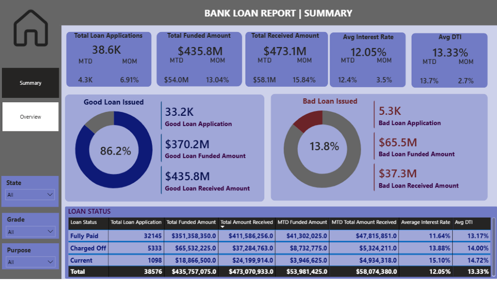
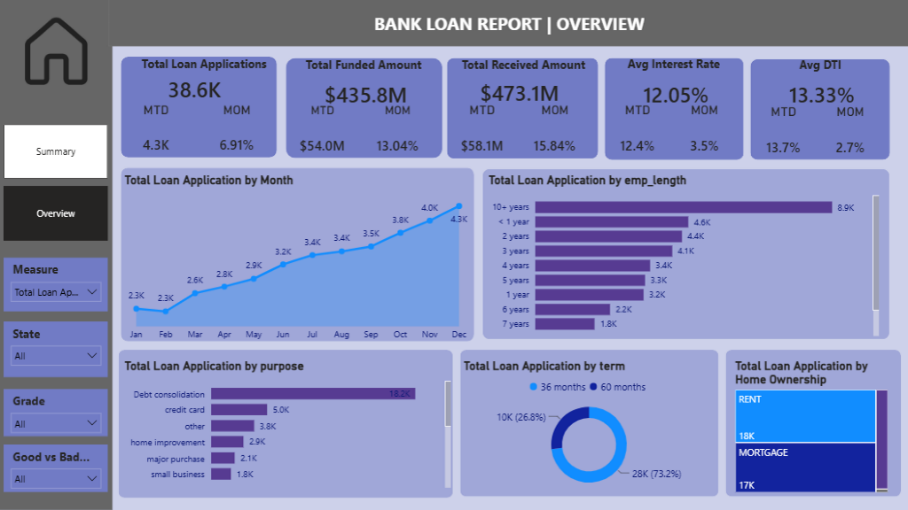

# 📊 Bank Loan & Credit Risk Analytics Dashboard

[](https://app.powerbi.com/view?r=eyJrIjoiNzRiM2IyODMtZTQ1Mi00MzU3LWEzMzQtZWU4ZGZlNTI2ZTRhIiwidCI6IjUxMzRkZDExLWZlNDEtNGY3My1iODIyLTg0NDljN2Y1MzA4MCJ9)


An interactive, enterprise-grade **Power BI Financial Lending & Credit Risk Dashboard** designed to evaluate loan portfolio health, monitor capital recovery velocity, and uncover borrower risk drivers across **38,576 loan applications**.

> 🔗 **Live Interactive Report**: [Click here to view the live published dashboard](https://app.powerbi.com/view?r=eyJrIjoiNzRiM2IyODMtZTQ1Mi00MzU3LWEzMzQtZWU4ZGZlNTI2ZTRhIiwidCI6IjUxMzRkZDExLWZlNDEtNGY3My1iODIyLTg0NDljN2Y1MzA4MCJ9)

---

## 📌 Business Problem & Objectives

### The Business Context
In bank loan portfolio operations, financial institutions face a constant strategic challenge: **maximizing lending volume while mitigating credit default risk**. Without centralized business intelligence, credit risk committees and lending executives face significant operational blind spots:
1. **Capital Exposure & Loss Visibility**: Inability to quantify how much capital is performing vs. written off in defaults, leading to inaccurate loss provisioning.
2. **Lending Velocity & Seasonality**: Lack of Month-to-Date (MTD) and Month-over-Month (MoM) monitoring to assess origination growth and cash collection health.
3. **Credit Risk Segmentation**: Difficulty identifying which borrower profiles (high DTI ratios, employment tenure, loan purpose, and repayment terms) correlate with higher charge-off rates.

### The Analytical Solution
This Power BI reporting system was engineered to deliver actionable, data-driven answers across two core analytical levels:
* **Executive Summary Dashboard**: High-level portfolio tracking, real-time MTD/MoM velocity metrics, Good vs. Bad loan segregation, and detailed loan status performance grids (`Fully Paid`, `Current`, `Charged Off`).
* **Overview & Risk Segmentation Dashboard**: Deep-dive multidimensional analysis across loan purpose, repayment terms (36 vs. 60 months), employment length, home ownership type, state-level geography, and monthly trends, supported by dynamic **Field Parameters** (`Select Measure`).

---

## 🖼️ Dashboard Preview

| Summary Page (Executive & Portfolio Health) | Overview Page (Demographics & Risk Segmentation) |
| :---: | :---: |
|  |  |

---

## 📈 Key Performance Indicators (KPI Summary)

### 1. Overall Portfolio Scale & Cash Flow
| Metric | Measure Name | Value | MTD (December) | MoM Growth |
| :--- | :--- | :---: | :---: | :---: |
| **Total Loan Applications** | `Total Loan Application` | **38,576** (~38.6K) | 4.3K | **+6.91%** |
| **Total Capital Funded** | `Total Funded Amount` | **$435.8M** | **$54.0M** | **+13.04%** |
| **Total Capital Received** | `Total Amount Received` | **$473.1M** | $58.1M | **+15.84%** |
| **Average Interest Rate** | `Average Interest Rate` | **12.05%** | 12.4% | **+3.5%** |
| **Average Debt-to-Income (DTI)** | `Avg Dti` | **13.33%** | **13.7%** | **+2.7%** |

---

### 2. Credit Risk Classification (Good vs. Bad Loans)
Loans were segmented based on repayment status to isolate default loss exposure:
* **Good Loans (`Fully Paid` & `Current`)**:
  * **Application Share**: **86.18%** (33,243 loans)
  * **Capital Funded**: **$370.2M**
  * **Cash Collected**: **$435.8M** (+$65.6M gross cash surplus)
* **Bad Loans (`Charged Off`)**:
  * **Application Share**: **13.82%** (5,333 loans)
  * **Capital Funded**: **$65.5M**
  * **Cash Collected**: **$37.3M** (**-$28.2M net capital write-off**)

---

### 3. Loan Status Performance Grid
| Loan Status | Applications | Total Funded ($) | Total Received ($) | Avg Interest Rate | Avg DTI |
| :--- | :---: | :---: | :---: | :---: | :---: |
| **Fully Paid** | 32,145 (83.3%) | $351.4M | $411.5M | 11.64% | 13.17% |
| **Current** | 1,098 (2.8%) | $18.9M | $24.2M | 15.10% | 14.72% |
| **Charged Off** | 5,333 (13.8%) | $65.5M | $37.3M | 13.88% | 14.00% |

---

## 🔍 Deep Analytical Insights

1. **Refinancing Concentration Risk**:
   * **Debt Consolidation** represents **47.2% (18,214 loans)** and **Credit Card refinancing** represents **13.0% (4,998 loans)**.
   * Together, debt refinancing comprises **>60%** of total borrower demand, exposing the institution to macroeconomic consumer debt cycles.
2. **Tenure & Term Disparity**:
   * **36-Month Term**: 73.2% of total volume (28,237 loans) with lower average interest rates (~11.1%) and lower default rates.
   * **60-Month Term**: 26.8% of volume (10,339 loans) with a higher average rate (~15.3%) and significantly higher default probability.
3. **Employment Stability Benchmark**:
   * Borrowers with **10+ years of employment tenure** represented the single largest borrower group (**8,879 loans / 23.0%**), exhibiting the highest repayment reliability.
4. **Asset Backing & Housing Risk**:
   * **Renters (47.9%)** and **Mortgage holders (44.6%)** represent **92.5%** of all applicants; outright **Homeowners** represent only **7.4%**, but demonstrate the lowest delinquency rates.
5. **Year-End Lending Surge**:
   * Loan originations grew steadily month-over-month from January (~2.3K applications) and peaked in December (4,314 applications, +13.0% funded MoM).

---

## 🛠️ Data Model & Technical Implementation

* **Schema Architecture**: Star schema centered on the `financial_loan` fact table, joined to a dedicated `Date Table` for dynamic time intelligence.
* **DAX Implementation**: Over 20 custom DAX measures built with `CALCULATE`, `DATESMTD`, `DATEADD`, and `DIVIDE` (see [DAX_Measures.md](DAX_Measures.md) for full code).
* **Dynamic Field Parameter (`Select Measure`)**: Integrated a dynamic measure switcher allowing users to toggle categorical bar/donut charts between *Total Loan Applications*, *Total Funded Amount*, and *Total Amount Received* without cluttering the canvas.
* **Interactive Navigation**: Custom page navigator, state slicers, purpose slicers, and grade slicers.

---

## 📂 Repository Structure

```text
├── assets/
│   ├── summary_view.png        # Executive Summary Page screenshot
│   └── overview_view.png       # Risk & Demographics Overview screenshot
├── Bank_Loan_Analysis_Report.pbix  # The complete interactive Power BI workbook
├── DAX_Measures.md             # Complete DAX formulas & technical dictionary
├── .gitignore                  # Git ignore rules for Power BI & OS files
└── README.md                   # Project documentation & insight breakdown
```

---

## 🚀 How to Open and Explore

1. Clone this repository (or download as ZIP from the green Code button above):
   ```bash
   git clone https://github.com/Curious011/Bank-Loan-Analysis-PowerBI.git
   ```
2. Download and install [Power BI Desktop](https://powerbi.microsoft.com/desktop/) (free).
3. Open `Bank_Loan_Analysis_Report.pbix`.
4. Interact with the slicers, date table filters, and dynamic measure toggle buttons!

---

## 👤 Author
* **Harsh Sharma**
* **Project**: Bank Loan Portfolio & Credit Risk Analytics
* **Tools**: Power BI, DAX, Power Query, Financial Data Analysis
